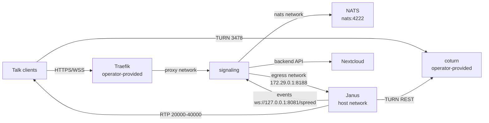

<!--
SPDX-FileCopyrightText: 2026 Travis Wichert

SPDX-License-Identifier: AGPL-3.0-or-later
-->

# Nextcloud Talk high-performance backend (HPB)

An Ansible role that deploys a [Nextcloud Talk high-performance backend](https://github.com/strukturag/nextcloud-spreed-signaling)
on a single node: the signaling server and the Janus MCU, both from hardened images
built by this repository. The NATS message bus comes from the separate
[`ansible-role-mash-nats`](https://github.com/littlecedar/ansible-role-mash-nats) role.

The role installs two systemd-wrapped containers:

| Component | Image | Role |
| --- | --- | --- |
| `nextcloud-spreed-signaling` | `ghcr.io/littlecedar/ansible-role-nextcloud-talk-hpb-spreed:2.1.1` | Signaling server: the only public HTTP/WebSocket endpoint |
| Janus | `ghcr.io/littlecedar/ansible-role-nextcloud-talk-hpb:1.4.3` | MCU: VideoRoom, WebSocket transport, WebSocket event handler |

The external TURN server (coturn) and the TLS reverse proxy (Traefik) are
operator-provided. **This role never deploys, packages or exposes either of them**:
it consumes their network, address and secret contract only.



## Requirements

- Linux with Docker and systemd on the target host.
- An external Docker network (`proxy` by default) that the reverse proxy is attached to.
  In MASH the component uses the playbook's
  `mash_playbook_reverse_proxyable_services_additional_network` (the Traefik component
  creates it when the playbook manages Traefik). Standalone, create it before running
  the role with `docker network create proxy`.
- A TURN server using TURN REST credentials (`coturn --use-auth-secret` or equivalent),
  sharing `nextcloud_talk_hpb_turn_static_auth_secret`.
- A Nextcloud instance with the Talk app.

### Role dependencies

The role expects the MASH (Mother-of-All-Self-Hosting) playbook to provide two
roles and their variables. They are **not** declared in `meta/main.yml`, so the
role stays usable standalone:

- `com.devture.ansible.role.playbook_help` — `devture_playbook_help_container_retries_*`
- `com.devture.ansible.role.systemd_docker_base` — `devture_systemd_docker_base_*`
  (systemd path, Docker command, pull and network-creation methods, network driver
  options, stop grace time, cleanup timeouts)

The NATS message bus is deployed by the
[`nats`](https://github.com/littlecedar/ansible-role-mash-nats) role, installed from
`git+https://github.com/littlecedar/ansible-role-mash-nats.git` at `v2.15.1-0` and run
before this role. It also is **not** declared in `meta/main.yml`. This role reads three
of its variables, and this role's own defaults derive from them:

| `nats` role variable | Read here as | This role's default |
| --- | --- | --- |
| `nats_token` | `nextcloud_talk_hpb_nats_token` | `{{ nats_token \| default('') }}` |
| `nats_identifier` | `nextcloud_talk_hpb_nats_hostname` | `{{ nats_identifier \| default('') }}` |
| `nats_container_network` | `nextcloud_talk_hpb_nats_network` | `{{ nats_container_network \| default('') }}` |

The only Ansible collection required is `community.docker` (`docker_network`,
`docker_network_info`, `docker_image_pull`, `docker_image_build`).

## Using the role in the MASH playbook

The playbook wires each role in with a *component*: a directory holding
`component.yml` (when the component is in use, where it runs and what it adds to
other components), `requirements.yml` (the role pin), `wiring.yml` (the role's
default configuration) and `with/<other>.yml` (configuration which applies only
while that other component is in use too). Your own components live in your
inventory, for example `inventory/components/nextcloud_talk_hpb/`. The playbook
generates `requirements.yml`, `setup.yml` and `group_vars/mash_servers/` from the
components; do not edit those generated files.

`inventory/components/nextcloud_talk_hpb/requirements.yml`:

```yaml
- src: git+https://github.com/littlecedar/ansible-role-mash-nats.git
  version: v2.15.1-0
  name: nats
- src: git+https://github.com/littlecedar/ansible-role-nextcloud-talk-hpb.git
  version: v1.4.3-1
  name: nextcloud_talk_hpb
```

`inventory/components/nextcloud_talk_hpb/component.yml` (the component is in use
when the inventory sets any variable starting with `nextcloud_talk_hpb_`):

```yaml
activation_prefix: nextcloud_talk_hpb_

inject:
  systemd_service_manager:
    services:
      - name: "{{ nextcloud_talk_hpb_signaling_identifier }}.service"
        priority: 2001
        restart_necessary: "{{ nextcloud_talk_hpb_restart_necessary | bool }}"
        groups: [mash, nextcloud-talk-hpb]
        when: "{{ nextcloud_talk_hpb_enabled }}"
      - name: "{{ nextcloud_talk_hpb_janus_identifier }}.service"
        priority: 2002
        restart_necessary: "{{ nextcloud_talk_hpb_restart_necessary | bool }}"
        groups: [mash, nextcloud-talk-hpb]
        when: "{{ nextcloud_talk_hpb_enabled }}"
```

No `setup` entry is needed: the component runs the role at the default priority,
after `nextcloud` (same priority, sorted by component name).

`inventory/components/nextcloud_talk_hpb/wiring.yml`:

```yaml
nextcloud_talk_hpb_enabled: false
nextcloud_talk_hpb_identifier: "{{ mash_playbook_service_identifier_prefix }}nextcloud-talk-hpb"
nextcloud_talk_hpb_base_path: "{{ mash_playbook_base_path }}/{{ mash_playbook_service_base_directory_name_prefix }}nextcloud-talk-hpb"
nextcloud_talk_hpb_uid: "{{ mash_playbook_uid }}"
nextcloud_talk_hpb_gid: "{{ mash_playbook_gid }}"
# 64 bytes (sha256 hex) keeps the signaling hash key inside its recommended 32/64-byte range;
# the block key must be 16, 24 or 32 bytes or the signaling server refuses to start.
nextcloud_talk_hpb_signaling_hash_key: "{{ (mash_playbook_generic_secret_key + ':nextcloud-talk-hpb.hash') | hash('sha256') }}"
nextcloud_talk_hpb_signaling_block_key: "{{ ((mash_playbook_generic_secret_key + ':nextcloud-talk-hpb.block') | hash('sha256'))[:32] }}"
nextcloud_talk_hpb_signaling_internal_shared_secret_key: "{{ (mash_playbook_generic_secret_key + ':nextcloud-talk-hpb.internal') | hash('sha512') }}"
nextcloud_talk_hpb_proxy_network: "{{ mash_playbook_reverse_proxyable_services_additional_network }}"
```

The `nats` component must be enabled in the same inventory: it provides `nats_token`,
`nats_identifier` and `nats_container_network`, and this role derives its three
`nextcloud_talk_hpb_nats_*` values from them, so the token is not repeated here.

`inventory/components/nextcloud_talk_hpb/with/nextcloud.yml` derives the Nextcloud
base URL while the Nextcloud component is in use:

```yaml
nextcloud_talk_hpb_nextcloud_url: "{{ nextcloud_scheme }}://{{ nextcloud_hostname }}{{ nextcloud_path_prefix }}"
```

`inventory/components/nextcloud_talk_hpb/with/traefik.yml` follows the playbook's
reverse-proxy settings while the Traefik component is in use:

```yaml
nextcloud_talk_hpb_signaling_container_labels_traefik_enabled: "{{ mash_playbook_traefik_labels_enabled }}"
nextcloud_talk_hpb_signaling_container_labels_traefik_entrypoints: "{{ traefik_entrypoint_primary }}"
nextcloud_talk_hpb_signaling_container_labels_traefik_tls_certResolver: "{{ traefik_certResolver_primary }}"
```

Then, in the inventory's `vars.yml`, set `nextcloud_talk_hpb_enabled: true`,
`nextcloud_talk_hpb_hostname`, `nextcloud_talk_hpb_public_ip`,
`nextcloud_talk_hpb_turn_static_auth_secret` and
`nextcloud_talk_hpb_signaling_secret`, plus `nextcloud_talk_hpb_nextcloud_url` when
the Nextcloud component is not in use. When the playbook uses no Traefik,
`mash_playbook_reverse_proxyable_services_additional_network` is empty; set
`nextcloud_talk_hpb_proxy_network` to the network your reverse proxy uses (the role
rejects an empty or missing network). Install the service
with `just install-service nextcloud-talk-hpb` (or
`just setup-service nextcloud-talk-hpb` to run the uninstall path too);
`nextcloud-talk-hpb` is the service name used by the component's `inject` entries
and by the systemd service group.

If you contribute the component to the playbook itself, its
`components/nextcloud_talk_hpb/README.md` is the service page: keep it next to the
wiring and link to the role's documentation
(`roles/galaxy/nextcloud_talk_hpb/docs/configuring-nextcloud-talk-hpb.md`) instead
of duplicating it.

See [`docs/configuring-nextcloud-talk-hpb.md`](docs/configuring-nextcloud-talk-hpb.md)
for the required variables, image overrides, the Traefik/coturn/Nextcloud contract and
the post-deployment steps.

## Networks

The role owns only its internal networks; the proxy network is external to it.

| Network | Type | Default | Purpose |
| --- | --- | --- | --- |
| `nextcloud-talk-hpb-egress` | bridge, `172.29.0.0/24`, gateway `172.29.0.1` | created by the role | signaling ↔ host-networking Janus |
| `proxy` | external | not created by this role | Traefik → signaling |

The signaling container also joins the `nats` role's internal network
(`nats_container_network`, default `nats`). That role creates and removes it; this one
only reads it through `nextcloud_talk_hpb_nats_network`.

## Ports

| Port | Scope | Service |
| --- | --- | --- |
| `443` | public | operator's Traefik (WebSocket upgrade for `/spreed`) |
| `20000-40000/udp` | public | Janus RTP/RTCP |
| `3478/tcp+udp` and the relay range | public | operator's coturn |
| `127.0.0.1:8081` | loopback | signaling HTTP; also the Janus event handler target |
| `127.0.0.1:8088` | loopback | Janus HTTP API |
| `172.29.0.1:8188` | egress subnet | Janus WebSocket transport |
| `4222` | `nats` role's network only (no host publish) | NATS |

`8081`, `8088` and `8188` must be dropped by the host firewall on public interfaces.

## Operating

```sh
journalctl -u nextcloud-talk-hpb-signaling -f
journalctl -u nextcloud-talk-hpb-janus -f
```

Containers log through systemd only (`--log-driver=none`). Setting
`nextcloud_talk_hpb_enabled: false` and re-running the playbook stops and removes
the units, the role's egress network and the base path. The external proxy network
is never removed, even with `nextcloud_talk_hpb_proxy_network_deletion_enabled: true`.
The NATS unit and its network belong to the `nats` role and are removed by it.

## Container images

Both defaults are consumed from GHCR; this repository builds and publishes them.
The published packages are public, so the role pulls them anonymously with no registry
login. If you mirror the images to private packages, authenticate the target Docker
daemon with a token that has `read:packages`. Only Janus supports a target-side
self-build. Spreed is used either from the published image or from an image you build
locally and point the role at with `nextcloud_talk_hpb_signaling_container_image` plus
`nextcloud_talk_hpb_signaling_container_image_pull: false`.

| Service | Build context | Default image | Pinned version |
| --- | --- | --- | --- |
| Janus | [`build/janus/`](build/janus) | `ghcr.io/littlecedar/ansible-role-nextcloud-talk-hpb:1.4.3` | Janus `1.4.3` (`1f0b75ca`) |
| Spreed signaling | [`build/spreed/`](build/spreed) | `ghcr.io/littlecedar/ansible-role-nextcloud-talk-hpb-spreed:2.1.1` | Spreed `2.1.1` (`e7a8fb7a`) |

Only Janus can be built on the target: set
`nextcloud_talk_hpb_janus_container_image_self_build: true` and the role clones this
repository and builds `build/janus` inside the instance. Spreed has no self-build path;
build it locally and set `nextcloud_talk_hpb_signaling_container_image_pull: false`.
The NATS image is built and published by the
[`ansible-role-mash-nats`](https://github.com/littlecedar/ansible-role-mash-nats)
repository. The molecule-only test client image lives in
[`build/test-client/`](build/test-client).

```sh
docker build -t ansible-role-nextcloud-talk-hpb:local build/janus
docker build -t nextcloud-talk-hpb-spreed:local build/spreed

./scripts/smoke-test-janus.sh ansible-role-nextcloud-talk-hpb:local
./scripts/smoke-test-spreed.sh nextcloud-talk-hpb-spreed:local
```

To run a locally built Spreed image, point
`nextcloud_talk_hpb_signaling_container_image` at it and set
`nextcloud_talk_hpb_signaling_container_image_pull: false`.

Janus pins: Ubuntu 24.04 base, Janus `1.4.3` (`1f0b75ca`), libnice `0.1.24`, libsrtp
`2.8.1`, libwebsockets `4.3.10`, usrsctp `c625e219`. Dependency versions are comments
next to their commit ARGs; bump them by changing the commit, since an unused version
ARG would be a misleading knob. Janus releases are picked up weekly by
`update-janus.sh`, which moves the `build/janus/Dockerfile` pins, the image tag and the
self-build release tag together.

The Spreed image builds from a pinned upstream tag. Its Dockerfile records both the
version and the commit and fails the build if the tag no longer points at that commit.
To upgrade Spreed, bump the version and commit in `build/spreed/Dockerfile`, update
`nextcloud_talk_hpb_signaling_container_image_tag` in `defaults/main.yml`, and update
the pin tables in this README and the configuration guide; the publish workflow then
builds the new tags.

Data channels (`usrsctp`) are enabled because the Nextcloud Talk signaling server
refuses an MCU without them (`Could not create janus MCU: data channels are not
supported`).

Janus hardening: non-root UID/GID `10001`, read-only root, all capabilities dropped,
`no-new-privileges`, no compiler or `-dev` package in the runtime, VideoRoom only,
no recordings and no post-processing, both Janus admin transports disabled,
TURN REST credentials generated into a mode-`600` tmpfs file with the secret unset
before `exec`. The Janus image supports configuration overrides from `/etc/janus.d`;
the role does not mount that directory, so an override must be mounted separately. See
[`conf.d/README.md`](conf.d/README.md) for the override format and mounting requirement.

Spreed hardening: non-root (the image defaults to UID/GID `1000`; the role runs it as
`nextcloud_talk_hpb_uid`/`gid`), read-only root, all capabilities dropped,
`no-new-privileges`, and a shell-free `scratch` runtime. The signaling configuration is
rendered by Ansible and mounted read-only; `SIGUSR1` provides graceful shutdown.

Image pipeline: `.github/workflows/ci.yml` runs on pull requests, builds and smoke-tests
both images, and runs molecule. `.github/workflows/publish.yml` runs on pushes to `main`
and on `workflow_dispatch`: it builds and smoke-tests both images, runs molecule, and
only then pushes tags — `sha-<short>` for every publish run, plus `edge`, `latest` and
the service version when the ref is `main`. No other workflow pushes images. This
repository builds and publishes two images; the NATS image is published by the
[`ansible-role-mash-nats`](https://github.com/littlecedar/ansible-role-mash-nats)
repository. Role releases (`v1.4.3-1`) are separate tags and never publish an image.

## Development

```sh
yamllint .
ansible-lint
shellcheck scripts/*.sh build/janus/docker-entrypoint.sh
ansible-galaxy role install -r molecule/default/requirements.yml   # once
ansible-galaxy collection install community.docker ansible.posix  # once
molecule test          # nested Docker inside a privileged VM-like container
```

`molecule test` builds the Spreed and test-client images in
`molecule/default/prepare.yml`, pulls the published NATS image and installs the `nats`
role from its release tag, stages the Janus source as a tagged repository so the role's
self-build path builds it inside the instance, then converges both roles, starts the
units, runs the HPB protocol client against the signaling server and asserts the
security and configuration invariants in `molecule/verify_tasks.yml`.

## License

AGPL-3.0-or-later. See [`LICENSE`](LICENSE).
